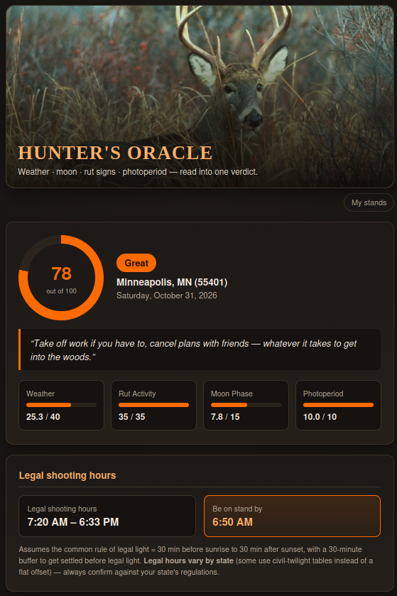

# 🔭 Hunter's Oracle

A local web app that estimates how good a day will be for deer hunting at a
given US zip code, up to 7 days out — blending live National Weather
Service forecasts, moon phase, whitetail rut timing, and your own recent
field observations into one 0-100 score, plus a folksy verdict on whether
it's worth skipping work for.



Runs identically on **Windows** and **Linux**. No API keys, no accounts, no
cloud service — it's a small Python web server that runs on your own
machine and opens in your own browser.

Built by [@PeterCottontail2023](https://github.com/PeterCottontail2023).

---

## Table of contents

- [What it does](#what-it-does)
- [The complete beginner's setup guide](#the-complete-beginners-setup-guide)
  - [Windows](#windows)
  - [Linux](#linux)
  - [Using it day to day](#using-it-day-to-day)
  - [Troubleshooting](#troubleshooting)
- [Using the app](#using-the-app)
- [What goes into the score](#what-goes-into-the-score)
- [My stands (wind advisor)](#my-stands-wind-advisor)
- [Project layout](#project-layout)
- [Image credit](#image-credit)
- [License](#license)
- [Limitations](#limitations)

---

## What it does

You give it a US zip code and a hunt date (today through 7 days out), and
optionally tell it what rut sign you've seen in the field in the last 72
hours. It comes back with:

- A **0-100 score** and grade (Poor → Exceptional), with a quotable, folksy
  verdict ("Take off work if you have to...")
- **Legal shooting hours** and the time you should be settled on stand
- **Weather detail**: peak high, daytime low, minimum wind chill, sky/precip
- A **12-hour chart** of temperature, wind chill, and precipitation chance
  starting at your stand time, with wind-direction arrows per hour
- A **wind & stand advisor** that — once you've told it about your own
  stands — recommends which one to sit based on the forecast wind

It's a heuristic planning aid built from commonly cited hunting folklore
and real weather data, not a scientific guarantee. See
[Limitations](#limitations).

---

## The complete beginner's setup guide

This section assumes you've never used `git` or a terminal before. If
you're already comfortable with those, skip to [Using the
app](#using-the-app).

You need two things before you start: **Python 3.9 or newer**, and **the
code itself**. Pick your operating system below.

### Windows

**1. Check whether Python is already installed.**
Press the `Windows` key, type `cmd`, press Enter to open Command Prompt.
Type:
```
python --version
```
If you see something like `Python 3.11.4`, you're set — skip to step 2.
If you see an error or it opens the Microsoft Store, you need to install it:

1. Go to <https://www.python.org/downloads/windows/> and download the
   latest Python 3 installer.
2. Run the installer. **On the very first screen, check the box that says
   "Add python.exe to PATH"** before clicking "Install Now" — this is the
   step almost everyone misses, and without it none of this will work.
3. Close and reopen Command Prompt, then re-run `python --version` to
   confirm it worked.

**2. Get the code.** Easiest way, no `git` required:

1. Go to this repo's page on GitHub.
2. Click the green **Code** button → **Download ZIP**.
3. Extract the ZIP somewhere you'll remember (e.g. your Desktop). You should
   end up with a folder named `hunters-oracle` containing files like
   `app.py` and `run.bat`.

(If you do have `git` installed, you can instead open Command Prompt and run
`git clone https://github.com/PeterCottontail2023/hunters-oracle.git`.)

**3. Run it.** Open the `hunters-oracle` folder in File Explorer and
**double-click `run.bat`**. A black Command Prompt window will pop up and do
some setup work (only on the first run — installing two small packages) —
this can take 10-20 seconds. Your default web browser should then open
automatically to the app.

**Leave that black window open** while you use the app — it's the running
server. Closing it stops the app. To use the app again later, just
double-click `run.bat` again (it'll start instantly the second time).

If Windows shows a security warning about running an unrecognized app,
that's normal for any script you didn't buy from a store — click **More
info → Run anyway**.

### Linux

**1. Check Python.** Open a terminal and run:
```
python3 --version
```
You need 3.9 or newer (most current distros already have this). If
`python3` isn't found at all, install it via your package manager (e.g.
`sudo apt install python3` on Debian/Ubuntu/Mint).

**2. Get the code.**
```
git clone https://github.com/PeterCottontail2023/hunters-oracle.git
cd hunters-oracle
```
If `git` isn't installed: `sudo apt install git` (or your distro's
equivalent), then try again. No `git`? Use GitHub's **Code → Download ZIP**
button instead and extract it, then `cd` into the extracted folder.

**3. Run it.**
```
./run.sh
```
If you get `Permission denied`, run `chmod +x run.sh` once, then try again.

First run builds a local Python virtual environment and installs two
packages (Flask, requests) automatically — this takes a few seconds. If
your system is missing the `venv` module entirely, the script will try to
install it itself via `sudo apt-get install python3-venv` (you'll be
prompted for your password — that's normal `sudo` behavior, not the app
doing anything sketchy). Your browser should open automatically once it's
running.

### Using it day to day

- **Start it:** `./run.sh` (Linux) or double-click `run.bat` (Windows).
- **Stop it:** close the terminal/Command Prompt window, or press `Ctrl+C`
  inside it.
- **Browser didn't open automatically?** Go to
  <http://127.0.0.1:5151/> yourself.
- Nothing needs reinstalling between runs — only the very first run does
  setup work.

### Troubleshooting

- **`ModuleNotFoundError: No module named 'flask'`** — this means a
  previous setup attempt got interrupted and left a half-built environment
  behind. The launcher now detects and auto-repairs this itself; if you
  somehow still hit it, delete the `.venv` folder inside `hunters-oracle`
  and run the launcher again.
- **Port 5151 already in use** (some other app is using it) — start on a
  different port: Linux: `PORT=5000 ./run.sh`; Windows (Command Prompt):
  `set PORT=5000 && run.bat`. Then browse to that port instead.
- **"Zip code wasn't found" or weather lookup fails** — check your internet
  connection, and double-check it's a valid 5-digit US zip (the app relies
  on `api.zippopotam.us` for geocoding and `api.weather.gov` for forecasts
  — both US-only and both need to be reachable).
- **Windows Firewall prompt** — the app only listens on your own machine
  (`127.0.0.1`), so you shouldn't see this, but if you do, it's safe to
  allow on private networks.
- **Still stuck?** Open an issue on the GitHub repo.

---

## Using the app

1. Enter your zip code and pick a hunt date (today through 7 days out).
2. If you've been in the woods in the last 72 hours, say so and check off
   whatever rut sign you've actually seen (fresh rubs/scrapes, chasing,
   tending grunts, nervous/bunched-up does) — this directly boosts the
   rut-activity portion of the score, since what you saw with your own eyes
   outweighs a calendar guess.
3. Hit **Consult the Oracle**.
4. Read the verdict, check the best dawn/dusk windows and the 12-hour
   chart, and see which of your stands (if you've added any) fits today's
   wind.

---

## What goes into the score

- **Weather** (40 pts) — cooling/cold-front trend into dawn, wind speed
  (ideal ~3-10 mph), sky/precipitation, and temperature comfort — pulled
  live from `api.weather.gov` (NWS), no API key needed.
- **Rut activity** (35 pts) — a latitude-based estimate of where the date
  falls relative to peak rut (pre-rut/seeking, chasing, lockdown, post-rut,
  second rut, etc.), **boosted by what you tell it** if you've seen rubs,
  scrapes, chasing, tending grunts, or nervous/bunched-up does.
- **Moon phase** (15 pts) — computed offline (no API); closer to new moon
  nudges the score up, closer to full moon nudges it down, per the
  classic (if folkloric) solunar daytime-movement theory.
- **Photoperiod** (10 pts) — day length for that date/location, offline
  sunrise/sunset calculation; also drives the dawn/dusk "best window"
  times shown on the result page.

The result page also shows, independent of the score:

- **Legal shooting hours** (sunrise − 30 min to sunset + 30 min, the common
  default — varies by state) and **"be on stand by"** time (30 min before
  legal light), plus **daytime low** temp and **minimum wind chill**
  (standard NWS formula) alongside the existing peak high.
- A **12-hour outlook chart** (temperature, wind chill, precipitation
  chance), starting at your "be on stand by" time — a hand-drawn inline SVG
  meteogram in the same style as the NWS graphical forecast, no charting
  library. Small vector arrows along the bottom show which way the wind is
  blowing *toward* each hour (i.e. where your scent goes).

The final score maps to one of five grades, each with its own blunt, folksy
verdict (`oracle/scoring.py` → `VERDICTS`, easy to edit if you want your own
wording).

Everything here is a documented **heuristic**, not a scientific predictor —
weights/thresholds live in `oracle/scoring.py` and `oracle/rut.py` if you
want to tune them.

## My stands (wind advisor)

Tag your own stands with the wind directions (the "from" direction, same
convention as a forecast) that keep your scent moving away from where you
expect deer to approach — you know your land, the app just matches the
forecast against it. Go to **My stands** (top-right nav) to add/remove
them; once you have at least one, the result page's wind & stand advisor
panel recommends one for dawn and one for dusk automatically. Stored
locally in `data/stands.json` — nothing leaves your machine, and it's
excluded from git via `.gitignore` since it's personal to your land.

---

## Project layout

```
app.py                     Flask routes (form -> predict -> result -> stands)
run.sh / run.bat            self-healing launchers (Linux / Windows)
oracle/
  geocode.py                 zip code -> lat/lon (zippopotam.us)
  weather.py                 NWS hourly forecast retrieval, parsing, wind chill
  astro.py                   offline sunrise/sunset, moon phase, legal hours
  rut.py                     rut-timing heuristic + field-sign blending
  wind.py                    compass normalization, dominant direction, scent-flow math
  stands.py                  persisted "my stands" CRUD (data/stands.json)
  chart.py                   hand-rolled inline-SVG 12-hour meteogram
  scoring.py                 combines everything into the final score + report + verdicts
templates/                  Jinja2 pages (form, result, stands)
static/css/style.css        blaze-orange theme
static/img/buck-photo.jpg   hero banner photo (see Image credit, below)
static/img/buck.svg         small badge mark, used as the browser-tab favicon
                            (code-generated, see tools/gen_buck_svg.py)
tools/gen_buck_svg.py       regenerates static/img/buck.svg if you want to
                            tweak the favicon (recursive antler-branch generator)
```

## Image credit

`static/img/buck-photo.jpg` is a U.S. Fish and Wildlife Service photo of an
adult white-tailed buck, via Wikimedia Commons:
https://commons.wikimedia.org/wiki/File:Adult_white_tailed_deer_buck_odocoileus_virginianus.jpg
— public domain as a work of a federal employee performed as part of
official duties (`PD-USGov-FWS`); no attribution is legally required, but
it's credited here as good practice. Resized/re-compressed for the web
(from 3658×2400 to 1100px wide); otherwise unedited.

## License

MIT — see [`LICENSE`](LICENSE). Use it, fork it, change the folksy verdicts
to your own voice, whatever you want.

## Limitations

- **US only** — both the zip geocoder and NWS are US-specific.
- NWS hourly guidance covers roughly 6-7 days out; a request for day 7 may
  have thinner data near the edge of that window (the app flags this when
  it happens).
- Rut-timing confidence is marked lower in the Deep South, where rut timing
  is genuinely more variable and sometimes double-peaked — your own field
  observations are weighted to matter more there.
- No accounts, no multi-device sync — it's a single-user local tool.
- Legal shooting hours shown use the common 30-min-offset rule; some states
  use civil-twilight tables instead. Always confirm against your state's
  actual regulations before heading out.
